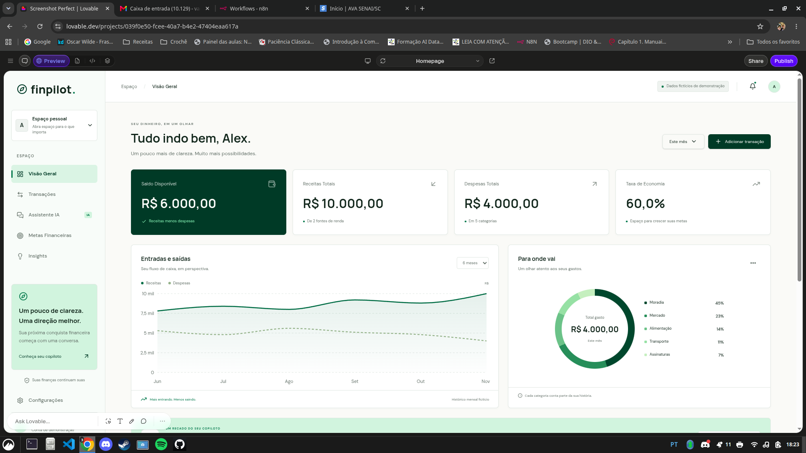
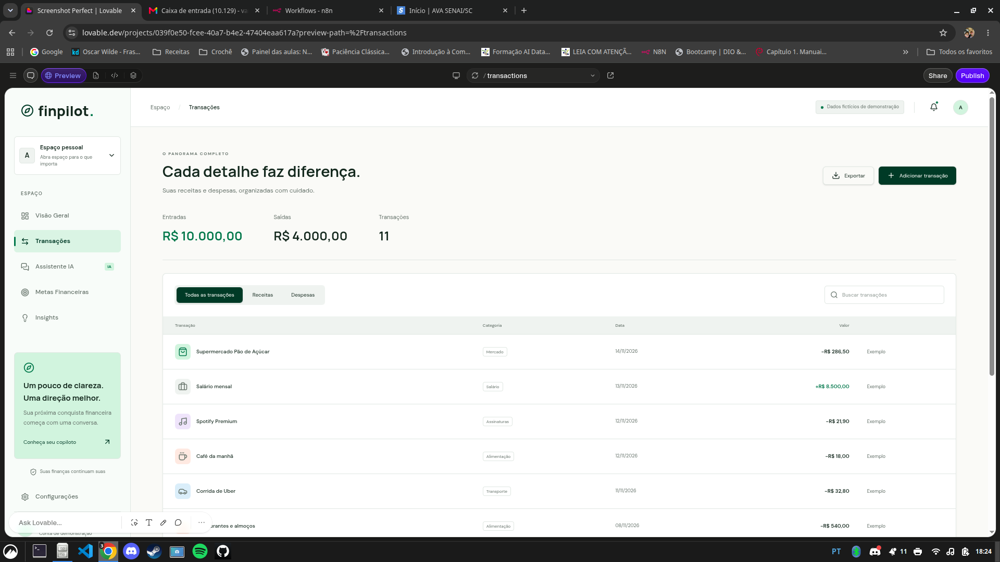
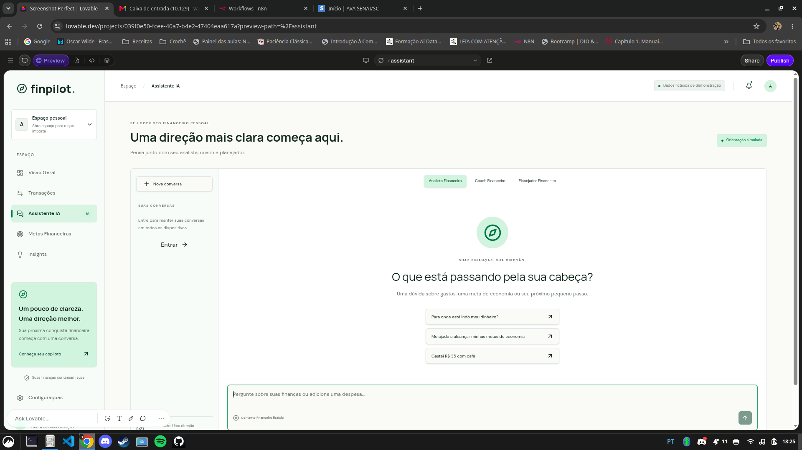
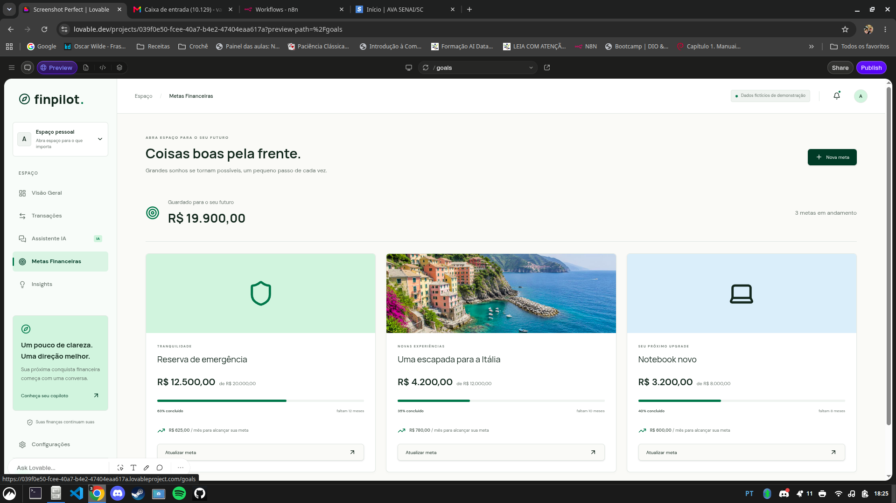
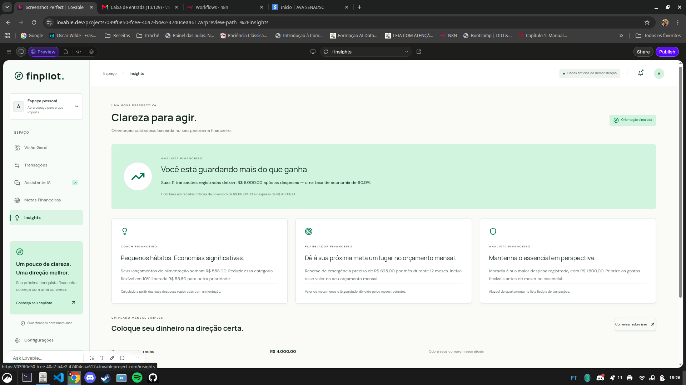

# 💚 FinPilot — Seu copiloto financeiro inteligente

**Your finances. Your direction.**

O FinPilot é um conceito de aplicativo de organização financeira pessoal que utiliza inteligência artificial, análise de dados e automação para ajudar pessoas a compreender melhor suas finanças, identificar padrões de consumo e alcançar objetivos financeiros.

O projeto foi desenvolvido como parte do desafio de Vibe Coding da [Digital Innovation One (DIO)](https://www.dio.me/), em parceria com o Santander.

## 🌐 Aplicação publicada

🔗 [Acessar FinPilot](https://pixel-perfect-recreation-2929.lovable.app)

**Aviso:** O protótipo utiliza dados financeiros fictícios e não realiza movimentações financeiras reais.

## 🎯 1. Problema e oportunidade

Muitas pessoas encontram dificuldades para organizar suas finanças pessoais devido à complexidade dos aplicativos tradicionais, à necessidade de registros manuais e à falta de recomendações personalizadas.

O FinPilot propõe uma experiência mais intuitiva, combinando análise financeira e inteligência artificial em uma única plataforma.

## 💡 2. Solução proposta

O FinPilot funciona como um copiloto financeiro inteligente, oferecendo três pilares:

- **Análise financeira:** identifica padrões de consumo e oportunidades de economia.
- **Orientação personalizada:** oferece informações educativas e sugestões contextualizadas.
- **Planejamento automatizado:** auxilia na criação de metas e estratégias financeiras.

## 👥 3. Público-alvo

Pessoas que desejam organizar suas finanças, compreender seus hábitos de consumo, controlar despesas e alcançar objetivos financeiros.

Especialmente iniciantes em planejamento financeiro que procuram uma experiência simples e acessível.

## ⚙️ 4. Principais funcionalidades

| Funcionalidade | Descrição |
|---|---|
| Dashboard financeiro | Visão geral de receitas, despesas, saldo e economia |
| Transações | Registro e categorização de movimentações |
| Assistente IA | Interface conversacional de orientação financeira |
| Metas financeiras | Criação e acompanhamento de objetivos |
| Insights inteligentes | Recomendações baseadas nos dados financeiros |
| Planejamento | Organização do orçamento pessoal |

## 🤖 5. Arquitetura conceitual de IA

O conceito utiliza três agentes especializados:

**Financial Analyst**
- Analisa receitas e despesas.
- Identifica padrões de consumo.
- Apresenta indicadores financeiros.

**Financial Coach**
- Oferece educação financeira.
- Sugere hábitos mais saudáveis.
- Explica oportunidades de economia.

**Financial Planner**
- Auxilia na definição de metas.
- Elabora sugestões de planejamento.
- Acompanha objetivos financeiros.

No protótipo, as respostas são simuladas. Não existe integração com um modelo de IA em produção.

## 📋 6. Product Requirements Document (PRD)

### Visão do produto

Criar uma aplicação moderna de organização financeira pessoal que combine inteligência artificial, análise de dados e planejamento automatizado.

### Problema

Aplicativos tradicionais frequentemente exigem muitos registros manuais e apresentam informações financeiras sem contextualização suficiente.

### Objetivo

Simplificar a organização financeira por meio de uma experiência conversacional e de análises compreensíveis.

### Requisitos funcionais

1. Registrar receitas e despesas.
2. Categorizar transações.
3. Apresentar indicadores financeiros.
4. Permitir a criação de metas.
5. Exibir recomendações personalizadas.
6. Disponibilizar um assistente financeiro conversacional.

### Requisitos não funcionais

- Interface responsiva.
- Navegação intuitiva.
- Clareza na apresentação dos dados.
- Proteção das informações pessoais.
- Transparência sobre recomendações geradas por IA.

### Escopo do MVP

O MVP contempla um protótipo com dados fictícios, navegação entre páginas, demonstração das funcionalidades financeiras e orientação simulada por IA.

Integrações bancárias e modelos avançados de Machine Learning não fazem parte do escopo inicial.

## ✨ 7. Prompt final utilizado

O desenvolvimento foi orientado pelo seguinte prompt:

```text
Create a modern and responsive personal finance
management application called FinPilot.

The application must provide a dashboard-first
experience, combining financial analytics,
conversational AI and personalized financial planning.

Visual identity:
- Dark forest green.
- Mint green accents.
- Warm white backgrounds.
- Minimalist fintech design.

Main features:
1. Financial dashboard.
2. Transaction management.
3. AI financial assistant.
4. Savings goals.
5. Personalized financial insights.
6. Financial planning.

Create three conceptual AI agents:
- Financial Analyst.
- Financial Coach.
- Financial Planner.

Use fictional Brazilian financial data,
formatted in Brazilian Real (BRL).

The prototype must include interactive navigation,
financial charts, transaction management,
savings goals and responsive layouts.

Use simulated AI responses and local
demonstration data.

Do not implement real bank integrations
or financial transactions.

Prioritize usability, accessibility,
visual consistency and a professional
fintech experience.
```

## 🧪 8. Validação do protótipo

Foram realizados sete testes manuais no ambiente de visualização do Lovable.

| Teste | Resultado |
|---|---|
| Acesso à página de transações | Aprovado |
| Acesso ao assistente IA | Aprovado |
| Acesso às metas financeiras | Aprovado |
| Acesso aos insights | Aprovado |
| Adição de transação | Aprovado |
| Carregamento do gráfico após atualização | Aprovado |
| Visualização em janela menor | Aprovado |

**Resultado: 7 de 7 testes aprovados.**

Os testes foram realizados manualmente e validam os comportamentos observados no protótipo.

## 🖥️ 9. Demonstração visual

As capturas de tela do projeto serão organizadas na pasta `assets/`.

### Dashboard


### Transações


### Assistente IA


### Metas financeiras


### Insights


## 🛠️ 10. Ferramentas utilizadas

- **Lovable:** criação do protótipo utilizando Vibe Coding.
- **Inteligência Artificial generativa:** estruturação de requisitos e geração da aplicação.
- **GitHub:** documentação e versionamento do projeto.

## 🔒 11. Segurança e privacidade

O conceito considera princípios de privacidade e proteção de dados, incluindo transparência, consentimento e proteção de informações pessoais, tendo a LGPD como referência.

O protótipo utiliza informações fictícias e não realiza movimentações financeiras reais.

## 💭 12. Reflexão sobre o processo

O desenvolvimento do FinPilot demonstrou como a inteligência artificial pode atuar como parceira no processo de concepção de produtos digitais.

Um dos principais aprendizados foi perceber a importância de estruturar bem os requisitos antes de solicitar a geração de uma aplicação. Um prompt claro, com contexto, funcionalidades e objetivos definidos, contribui para resultados mais alinhados à proposta do produto.

O processo também mostrou que gerar uma aplicação não é suficiente. É necessário avaliar o resultado, testar funcionalidades, identificar inconsistências e pensar na experiência do usuário.

Outro aprendizado importante foi compreender que a IA pode acelerar etapas do desenvolvimento, mas a capacidade humana de analisar, questionar e validar os resultados continua sendo essencial.

O FinPilot representa um exercício de integração entre inteligência artificial, análise de dados, automação e desenvolvimento de produtos digitais.

---

**Projeto desenvolvido para o desafio de Vibe Coding — DIO / Santander 2026.** 💚
